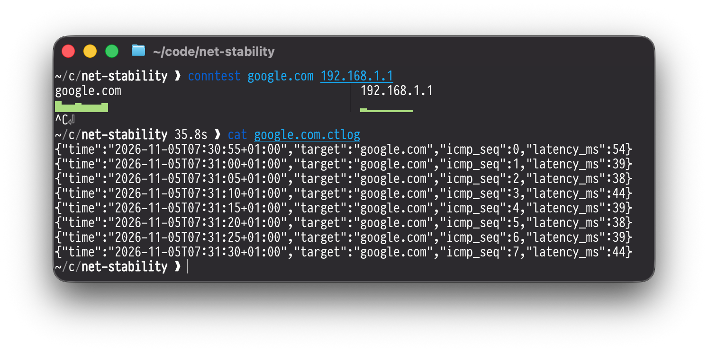

# ConnTest

A cli program that can monitor multiple targets at once every 5 seconds via ICMP ping.
It displays a bar for every ping response on the terminal, and logs the responses into
a file for each target for later analysis.

